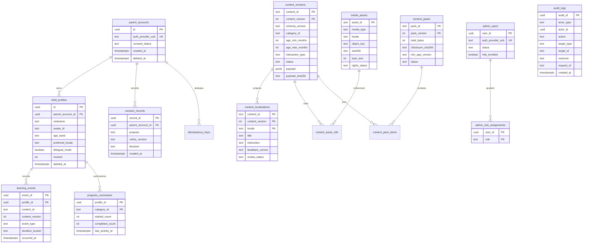

# Little Genius — Architecture Plan (Phase 1)

Status: planning baseline for product, engineering, privacy, and QA review.
Source: `internal/little-genius-production-requirements-v1.docx` (v1.0) plus the stack constraints in the architecture assignment.
This document is an engineering plan. It is not a privacy impact assessment, a legal opinion, or a claim that any store policy or statute is met.

No application repository exists. Nothing in this plan is implemented code.

## 1. Recommendation

Build Little Genius as one Flutter client and one TypeScript API.

- **Client:** a single Flutter/Dart app in `apps/mobile_web` for iOS, Android, and Web. Riverpod, GoRouter, Dio, Freezed, ARB localization (`en`, `hi`, `ta`). Native persistence is Drift (SQLite). Web persistence is an IndexedDB adapter behind the same repository interface. The web build does not open SQLite, including SQLite compiled to WebAssembly.
- **API:** a Fastify modular monolith on Node.js 24 LTS. TypeScript, Zod validation, PostgreSQL 17, Prisma 6.x, OpenAPI 3.1 published from the same schemas that validate traffic. Docker for local and deployed API images.
- **Content:** versioned JSON documents rendered only by an allowlist compiled into the app. Unknown interaction types and unknown schema versions fail safe. Content JSON never executes code.
- **Data:** local-first. A parent can create a profile and complete a downloaded lesson with no account and no network. Account sync is optional, explicit, and idempotent. The server stores age bands, not birth dates. PostgreSQL `jsonb` is used only for the immutable versioned lesson document.
- **v1 infrastructure default:** one API process, managed PostgreSQL, private object storage, and a CDN. No Redis. Asynchronous deletion, export, and media work use a PostgreSQL outbox.

The first shippable increment is the vertical slice in §8: one local profile, English/Hindi/Tamil, one real lesson, the allowlisted renderer, local progress, and offline play.

## 2. Deviations from the requirements baseline

| # | Requirements baseline | This plan | Why |
| --- | --- | --- | --- |
| 1 | Flutter vs React Native stays open until a spike (§8.3, §18). | Flutter is selected, with the package set in §5. | The architecture assignment fixes the client stack. A tracing and audio benchmark still runs in Phase 2 on reference phones; it can change activity design, not the framework. |
| 2 | MVP clients are iOS and Android. A public web learning client is not required (§2.1). | `apps/mobile_web` is one Flutter project with iOS, Android, and Web targets. Store submission can still be mobile-first. | The assignment requires one codebase and web-safe persistence. Web is a build target of that codebase. |
| 3 | Web storage is unspecified. | Web uses IndexedDB object stores for profiles, progress, lesson documents, and asset blobs. Drift/SQLite is compiled only into the iOS and Android builds. | Drift’s web path embeds `sqlite3.wasm`. That assumes SQLite in the browser. The assignment forbids that assumption. Browser storage can also be evicted; the parent UI must say so (§10). |
| 4 | Profiles may store an age band or birth month/year (FR-003, §6.3). | Profiles store an age band only. | Birth month and year are not needed to choose activities. Omitting them is stricter minimization and removes a field the privacy review would otherwise have to justify. Content documents may still declare `minMonths`/`maxMonths`. |
| 5 | Illustrative lesson JSON mixes render fields with `status` and `review` (§6.2). | The client document is a render payload. Review, rights, and publish state stay in relational columns. | A published version is immutable. Review state changes must not rewrite it. The client also must not treat authoring flags as instructions. |
| 6 | §8.2 names a queue for export, deletion, and media processing. | The queue is a PostgreSQL `job_outbox` drained with `FOR UPDATE SKIP LOCKED`. No Redis. | There is no running system and no measured need for a second datastore. The bar for adding Redis is in §5.4. |
| 7 | Illustrative routes are `/v1/...` (§7.2). | Public and parent routes are `/api/v1/...`. Staff routes are `/admin/v1/...`. | The assignment fixes the public prefix. Admin stays on a separate prefix so published-content routes and CMS routes are not one audience. |
| 8 | Identity provider is an open decision (§18). | The API speaks OIDC (Authorization Code + PKCE). Until Product and Security choose a vendor, the assumed provider is Amazon Cognito in the same region as the database. | A managed issuer avoids storing passwords. The assumption is named so backend design can proceed; it is not a vendor award (§5.3, ADR 004). |
| 9 | Hosting, region, and CDN are open (§18). | The assumed media pair is Amazon S3 (private bucket) and CloudFront. Keys are content-addressed. Clients receive short-lived signed GET URLs. | The API depends on a blob store and a CDN, not on AWS specifically. Replacing the vendor means replacing the storage adapter (§5.5). |
| 10 | Server `ChildProfile.parentAccountId` is described as nullable because local profiles have no account (§6.3). | The server table’s `parent_account_id` is `NOT NULL`. Local-only profiles have no server row. | A nullable FK would invite uploading local profiles by default. Absence of a row is the local-mode representation. |
| 11 | Email or phone “if needed” on `ParentAccount` (§6.3). | v1 PostgreSQL stores the IdP subject (`sub`) and consent/account state. Email and phone stay at the IdP. | The learning product does not need a second copy. Export and deletion call the IdP. Support lookups go to the IdP under admin auth. |
| 12 | FR-021 requires a CMS before content can be operated at scale. | The vertical slice ships one human-reviewed lesson as a signed fixture. The CMS is Phase 4, and it is mandatory before a second lesson is published. | The slice has to prove render, offline, and progress without blocking on editorial software. The fixture path is not the production publishing process. |

Decisions that remain open, including launch jurisdictions, are in §10. They are not silently closed here.

## 3. Repository structure

Proposed root (no remote is chosen yet):

```text
little-genius/
  apps/
    mobile_web/                 Flutter app: iOS, Android, Web
      lib/
        routing/                GoRouter: child space, parent gate, parent space
        features/               onboarding, profile, home, player, downloads, parent
        content/                schema parser, allowlist renderer, fallback
        data/                   repositories; drift/ (io); indexeddb/ (web)
        l10n/                   app_en.arb, app_hi.arb, app_ta.arb
  services/
    api/                        Fastify modular monolith
      src/modules/              health, content, profiles, progress, privacy, admin, jobs
      prisma/                   schema and migrations
      openapi/                  generated OpenAPI checked into CI
    content_admin/              staff-only frontend; calls /admin/v1 only
  packages/
    content_schema/             JSON Schema 2020-12 for the lesson document (source of truth)
  infrastructure/
    docker/                     Compose: postgres + api. Dockerfiles. No Redis service.
    scripts/                    seed the one reviewed lesson fixture; verify checksums
  docs/
    architecture-plan.md
    PRD.md
    ADR/
```

`packages/content_schema` is JSON Schema, not a Dart or TypeScript dialect. The API generates Zod (or a checked Zod mirror) from it. The Flutter app uses a Freezed parser that accepts only supported `schemaVersion` values and allowlisted `interaction.type` values. The two parsers are contract-tested against the same fixtures.

### When a separate admin frontend is justified

A separate **backend service** for admin is not justified in v1. Authoring, review, publish, and audit are modules inside the monolith, mounted at `/admin/v1`, with their own auth plugin, rate limit, and database role. One deployable, one migration history, one request-id and audit path.

A separate **admin frontend** is justified at Phase 4, when staff start authoring, and not before:

- Drafts, three-locale copy, asset upload, review queues, and publish are a different product surface from the child app.
- That UI must never be linked from a child route, and admin tokens must never be packaged in the store binary.
- Staff sign-in requires MFA and a different IdP application (or user pool) from parents.

`services/content_admin` is that frontend: a private TypeScript app, deployed behind staff SSO or a private ingress, talking only to `/admin/v1`. It is not part of the vertical slice. The slice’s one lesson is loaded by a reviewed fixture (§2, deviation 12).

Split admin into its own API process only if a later threat model requires a network boundary that route-level auth and a private ingress cannot provide.

### Client shape

GoRouter has two trees.

- **Child:** `/` home, `/c/:categoryId`, `/a/:contentId`. One primary action per screen. No external URLs. Back and home are always available. Modals only for safety or an OS permission the slice does not request.
- **Parent:** `/parent/...` for profiles, language, downloads, session limit, privacy, and (later) account and progress. Every entry goes through an in-app adult gate. The gate result lives in memory, ends when the app leaves the foreground for more than a minute, and is not persisted. The gate is an engineering control. Whether it satisfies a given store’s kids rules is a review item, not a property of this plan.

Riverpod owns profile, locale, download, and session-timer state. Widgets do not call Dio or Drift directly.

### API modules

| Module | Routes | Auth |
| --- | --- | --- |
| health | `/api/v1/health`, `/api/v1/health/ready` | none |
| content | manifest, version pointer, lesson document, asset descriptor | none for published content; rate-limited |
| profiles | `/api/v1/profiles` | parent access token |
| progress | events batch, summary | parent access token; ownership check |
| privacy | export, delete account (Phase 5; shapes sketched in §7.6) | parent; re-authentication |
| admin | `/admin/v1/...` | staff token, MFA, role |
| jobs | no public routes; polls `job_outbox` | database role |

Published-content handlers and parent-data handlers are separate Fastify encapsulations. A content route cannot query `child_profiles`.

## 4. Logical architecture

```text
Flutter app (iOS / Android / Web)
  presentation: widgets, allowlisted renderer, parent gate
  domain: age-band filter, locale resolution, session timer, progress
  data: repositories
        |-- native: Drift (SQLite) + file cache
        |-- web:    IndexedDB (documents, rows, blobs)
        |-- remote: Dio -> /api/v1  (optional)
        |-- outbox: local rows, uploaded only in account mode

Fastify monolith
  content module -> published rows + signed CDN URLs
  profile/progress module -> PostgreSQL (ownership checks, idempotency)
  job worker (same codebase) -> job_outbox
  admin module -> drafts, review, publish, audit

PostgreSQL 17          private object storage + CDN
  relational rows        image/audio bytes, key = sha256
  jsonb lesson payloads  no public list, no admin keys on clients
```

Local mode never constructs a Dio call for profiles, progress, or consent. The content client may download a pack when the network is available, then stops. Account mode writes the same local tables first, then enqueues an outbox batch.

In-session content is pinned. A manifest refresh must not replace the lesson document already open.

## 5. Dependencies and infrastructure

Versions are selection decisions. Lockfiles do not exist until a repository is created. Pin exact versions there, commit the lockfile, and record an SBOM. Accept a package only on a permissive license (MIT, BSD, Apache-2.0, PostgreSQL License, or SIL OFL for fonts).

### 5.1 Runtime pins

| Component | Pin | Why |
| --- | --- | --- |
| Node.js | **24 LTS** (`node:24-bookworm-slim` image). Security support through 2028-04-30. | In LTS since 2025-10-28. Node.js 26 entered Active LTS on 2026-10-28. Stay on 24 until Fastify and Prisma state support for 26. Do not use Node 27 (alpha as of this plan). |
| PostgreSQL | **17** | Transactions, constraints, `jsonb`, and `FOR UPDATE SKIP LOCKED` are core. PostgreSQL 18 is acceptable if it is the managed default in the chosen region. No extra extensions. |
| Prisma | **6.x stable line**, Apache-2.0 | Migrations, PostgreSQL, TypeScript client, `jsonb` on the one payload column. Prisma 8 was still a release candidate on 2026-10-07. Do not start v1 on a release candidate. Revisit 8 only after general availability. |
| Flutter | current **stable** channel, pinned in the toolchain file when the repo exists | One codebase for the three targets. BSD-3-Clause. |

### 5.2 Client packages

| Package | Role | Why this one |
| --- | --- | --- |
| `flutter_riverpod` | State | MIT. Maintained, testable without UI, standard Flutter choice. |
| `go_router` | Navigation | BSD-3-Clause. Flutter-team router. Declarative redirects implement the parent gate. |
| `dio` | HTTP | MIT. Interceptors attach `Idempotency-Key`, request id, and (later) the parent bearer token. Used only above the local-mode line. |
| `freezed` + `json_serializable` | Models | MIT. Immutable lesson and API models. Parsing is the point where unknown content fails. |
| `drift` + `drift_flutter` + `sqlite3_flutter_libs` | Native database | MIT. Drift is actively maintained and is the native store only. SQLite itself is public domain. Not compiled into the web build. |
| `package:web` | Web IndexedDB | BSD-3-Clause, Dart team. A small first-party adapter. No third-party IndexedDB wrapper until that adapter is shown to be insufficient. |
| `flutter_localizations`, `intl` | ARB `en` / `hi` / `ta` | BSD-3-Clause, Flutter team. UI chrome only. Lesson copy lives in content documents, not in ARB. |
| `just_audio` | Play, pause, replay | MIT, with ExoPlayer under Apache-2.0. iOS, Android, and Web. Cached files and remote URLs. The app never sets loop. Interruptions pause playback (requirements TC-009). |
| `crypto` | SHA-256 | BSD-3-Clause, Dart team. Verify pack and asset bytes before use. |
| `path_provider` | Native cache directories | BSD-3-Clause, Flutter team. |
| Noto Sans, Noto Sans Devanagari, Noto Sans Tamil | Bundled fonts | SIL OFL 1.1. Shipped in the binary so Hindi and Tamil do not depend on a device font or a runtime download. |
| `flutter_secure_storage` | Phase 5 only | Keychain and Keystore for refresh tokens on iOS and Android. Confirm the SPDX identifier in the SBOM at pin time. Not used on web (§5.3). |

Not in the client, at any phase, unless a later reviewed requirement adds them: Firebase, advertising SDKs, attribution SDKs, crash SDKs, microphone, camera, location, contacts, WebView, and any HTML renderer.

### 5.3 Authentication assumption

No vendor has been chosen. **Assumption until Product + Security replace it: Amazon Cognito user pools, OIDC, Authorization Code with PKCE.**

- Parents and staff are different app clients (or different pools). Children are not principals and have no credentials.
- Access tokens are short-lived JWTs. The API checks issuer, audience, signature, and expiry. Refresh tokens rotate. The API stores `sub`, not passwords.
- Admin roles require MFA enrolled before any `/admin/v1` call. The API rejects staff tokens whose MFA claim is absent.
- iOS and Android store refresh tokens in the platform keystore (Phase 5).
- Web account mode is not part of v1 launch. Browsers do not provide Keychain-equivalent storage. Web stays local-mode until a reviewed design exists (short-lived in-memory access token and a `Secure`, `HttpOnly`, `SameSite` session cookie). Local-mode web does not set that cookie.
- Region follows the confirmed launch jurisdiction. If the launch market remains India, the working assumption is `ap-south-1`, still subject to the hosting decision.

Any other OIDC issuer (for example Auth0) can replace Cognito if it provides PKCE, refresh rotation, revocation, account deletion, MFA for staff, and a data-processing terms review. The API must not import a vendor SDK that pulls in analytics.

Firebase Auth is not the default. Shipping it tends to arrive with adjacent Google client SDKs, and those SDKs are a poor fit for a children’s app that is trying to keep the client SDK list short.

### 5.4 Redis

**v1 does not run Redis and does not depend on a Redis client.**

Rate limits use `@fastify/rate-limit` with its in-process store. That is correct while the API is a single instance. The job worker uses `job_outbox`.

Add Redis only after one of these is measured:

- more than one API instance must share a rate-limit counter, or
- the outbox cannot drain export/deletion/media jobs inside the agreed recovery window, or
- a profiled hot path needs a shared cache that PostgreSQL cannot serve.

None of these can be demonstrated before the system exists. Do not add Redis “so we have a queue.”

### 5.5 Object storage, CDN, Docker, secrets

**Object storage and CDN (assumption):** private S3 bucket, CloudFront, SSE on the bucket, content-addressed keys (`sha256` of the bytes). The lesson JSON contains asset ids and checksums, never a storage URL. `GET /api/v1/assets/{assetId}` returns a signed URL with a short expiry. Admin upload URLs are minted only by `/admin/v1` after role checks. Block SVG, HTML, and JavaScript uploads. Allow `image/jpeg`, `image/png`, `image/webp`, `audio/mpeg`, `audio/mp4` (AAC). Starting size caps: 1 MB per image, 2 MB per short instruction clip. Longer story audio is a content-budget decision before Phase 4.

Signing keys and bucket credentials exist only on the API task role.

**Docker:**

- `infrastructure/docker/compose.yaml`: services `postgres` (17) and `api`. No Redis service.
- API image: multi-stage build from `node:24-bookworm-slim` (Debian slim avoids Prisma engine issues on Alpine), non-root user, `npm ci` from the lockfile, no dev dependencies in the final stage.
- The same image runs `node dist/server.js` or `node dist/worker.js`.
- Compose publishes Postgres and the API on localhost only.
- Flutter is built by CI on Flutter’s toolchain, not inside the API image.

**Secrets:**

- Nothing secret in the Flutter binary, the git repo, OpenAPI examples, or CI logs.
- Local development uses an untracked env file. The committed example contains placeholders.
- Production secrets live in the cloud secrets manager of the chosen host (AWS Secrets Manager if the storage assumption stands). The task role reads them at start. Images do not bake them in.
- Two database roles: `app` (DML on application tables, `INSERT` only on `audit_logs`) and `migrator` (DDL, used only by the migration job).
- Separate credentials for development, staging, and production. Development uses synthetic data. Production child data is never copied into another environment.

**Environments:** development, staging, production. Staging is production-like and access-restricted. Feature flags live in an `operational_settings` table edited by administrators. A flag must not disable the renderer allowlist, the parent gate, or deletion.

**Backups:** managed PostgreSQL backups and object-storage versioning. Initial proposal from the requirements: RPO ≤ 24 hours, RTO ≤ 8 hours. Those numbers are not approved. Retention and backup expiry are open legal/operations decisions (§10). A restore drill is a Phase 6 release gate, not a claim that recovery already works.

**Logging:** Pino via Fastify. Redact `authorization`, cookies, nicknames, and raw lesson responses at the logger. Crash and product analytics SDKs are out of v1. First-party aggregate operational metrics (request latency, 5xx rate, download failures, sync failures) are in scope in Phase 6 and must not include child identifiers.

## 6. Initial database model

Age band on a profile is one of `1-2`, `2-3`, `3-4`, `4-5`. The parent chooses it. The server does not derive it from a date of birth, because it does not store one.

Content eligibility: a profile’s band maps to months `1-2` → 12–24, `2-3` → 24–36, `3-4` → 36–48, `4-5` → 48–60, boundaries included. An activity is eligible when its `[minMonths, maxMonths]` overlaps that range. Overlap at 24, 36, and 48 months is intentional so a boundary activity can appear in both neighboring bands. The profile still has exactly one band.

`jsonb` appears on exactly one column: `content_versions.payload`, the immutable render document. Localized titles and instructions used for admin search are ordinary columns projected from that document in the publish transaction. The payload remains canonical.

### 6.1 ER diagram



`audit_logs` has no foreign key to accounts, profiles, or admin users. Deleting a person must not delete the record of the deletion. The application role may insert audit rows and may not update or delete them.

`idempotency_keys` stores `key`, `parent_account_id`, `request_sha256`, `status_code`, and the response body, with a unique constraint on `(parent_account_id, key)`.

`job_outbox` stores `job_id`, `job_type`, `payload` (job arguments, not lesson documents), `available_at`, and `attempts`. This payload is operational JSON for a closed set of job types (`export_account`, `delete_account`, `process_asset`). It is not a second content-document store. If a review prefers these arguments as columns, the JSON column can be removed without affecting lesson documents.

### 6.2 Keys, constraints, immutability

- Primary keys for people and events are UUID v4. Do not use UUID v1.
- `child_profiles.age_band` ∈ {`1-2`,`2-3`,`3-4`,`4-5`}. `preferred_locale` ∈ {`en`,`hi`,`ta`}.
- `nickname` is 1–24 Unicode characters after control characters are stripped. It is not unique and is not a legal name. `avatar_id` must be one of the built-in set (`star`, `sun`, `leaf`, `moon`, `bird`, `fish`). No photo upload.
- `learning_events.event_id` is client-generated and is the primary key. `event_type` ∈ {`started`,`completed`} for v1. `duration_bucket` ∈ {`lt_1m`,`m1_to_5`,`gt_5m`} or null. No coordinates, no tap stream, no free text.
- `progress_summaries` is updated in the same transaction as the event insert. `completed_count` increments only when a `completed` event is inserted, not when a duplicate `event_id` is ignored.
- `content_versions` primary key is `(content_id, content_version)`. A `BEFORE UPDATE` trigger rejects changes to `payload`, `payload_sha256`, `schema_version`, and age/interaction columns when `OLD.status = 'published'`. The allowed published transition is `published` → `unpublished`, which does not alter `payload`.
- `payload` must be a JSON object. Zod (from the shared JSON Schema) validates it before insert. The database constraint is the backstop, not the full allowlist.
- `content_localizations` rows are written in that same publish transaction. Draft deletes cascade to draft localization rows. Published version deletes are not offered; operators unpublish.
- `media_assets.sha256` is the checksum of the object bytes. `content_asset_refs` prevents deleting an asset that a published version still cites (`ON DELETE RESTRICT`).
- `content_pack_items` pins exact `(content_id, content_version)` pairs. A pack checksum covers the ordered list of those ids and versions.

### 6.3 Deletion behavior

Retention periods are **not approved**. The mechanics below describe what the software must do once privacy and operations set those periods. They do not define a lawful retention schedule.

| Action | Behavior |
| --- | --- |
| Clear local history | Device only. Deletes local events, summaries, and cached lesson state for that profile. No network call in local mode. |
| Delete child profile (account mode) | Parent-authenticated. Soft-delete the profile (`deleted_at`, nickname cleared). Hard-delete that profile’s `learning_events` and `progress_summaries` in the same transaction. Further batches for that id return `404 PROFILE_NOT_FOUND`. The client drops the outbox. |
| Delete child profile (local mode) | Device only. No server row exists. |
| Delete parent account | Re-authenticate. Revoke refresh tokens at the IdP. Soft-delete `parent_accounts`. Run profile deletion for every child profile. Enqueue `delete_account`. While the job is unfinished, sync routes refuse uploads. Consent rows are kept (`ON DELETE RESTRICT` if a hard-delete is ever attempted) until the approved consent-retention job removes or de-identifies them. Audit rows stay. Backups expire only under the approved backup rule. |
| Offline delete | The client must not show success. It queues the intent only in account mode and shows that a network connection is required to finish, or it tells the parent the network is required if the product chooses not to queue (pick one in Phase 5 and test TC-012). |
| Unpublish content | Status flip only. Downloaded copies remain usable until the parent removes them or a security/content kill is explicitly issued. A kill is a manifest withdrawal plus a minimum app rule, not a silent rewrite of local progress. |
| Delete draft asset | Allowed when no published ref exists. |
| Admin offboarding | Disable `admin_users.status`, revoke IdP sessions. Audit of their past actions remains. |

Server ownership is checked on every profile and progress query: `profile.parent_account_id = token.sub’s account`. A missing profile and another parent’s profile return the same `404` body.

## 7. API contract (vertical slice)

OpenAPI 3.1 draft. Base path `/api/v1`. JSON, UTF-8. Authenticated routes use `Authorization: Bearer <access_token>`. Every response includes `X-Request-Id`. Clients send `Idempotency-Key` (UUID) on the POSTs marked below.

Child-visible errors are **not** the server `message`. The app maps `code` to an ARB string. `message` is a short parent-safe English sentence for logs and the parent UI.

### 7.1 Shared error

```yaml
Error:
  type: object
  additionalProperties: false
  required: [error]
  properties:
    error:
      type: object
      additionalProperties: false
      required: [code, message, requestId, retryable]
      properties:
        code:
          type: string
          enum:
            - UNAUTHENTICATED
            - VALIDATION_ERROR
            - PROFILE_NOT_FOUND
            - CONTENT_NOT_FOUND
            - CONTENT_VERSION_UNAVAILABLE
            - ASSET_NOT_FOUND
            - REVISION_CONFLICT
            - IDEMPOTENCY_KEY_REUSE
            - PROFILE_ID_CONFLICT
            - PAYLOAD_TOO_LARGE
            - RATE_LIMITED
            - INTERNAL
        message: { type: string, maxLength: 200 }
        requestId: { type: string }
        retryable: { type: boolean }
```

| HTTP | code | retryable | When |
| --- | --- | --- | --- |
| 400 | `VALIDATION_ERROR` | false | Body, query, or path fails schema. |
| 401 | `UNAUTHENTICATED` | false | Missing or invalid parent token on a parent route. |
| 404 | `PROFILE_NOT_FOUND` | false | No profile for this parent with that id, including profiles owned by someone else. |
| 404 | `CONTENT_NOT_FOUND` | false | Unknown id, or nothing published. |
| 404 | `CONTENT_VERSION_UNAVAILABLE` | true | That version is not currently published. |
| 404 | `ASSET_NOT_FOUND` | false | Unknown asset id. |
| 409 | `REVISION_CONFLICT` | false | Profile `PATCH` revision does not match. |
| 409 | `IDEMPOTENCY_KEY_REUSE` | false | Same key, different request hash. |
| 409 | `PROFILE_ID_CONFLICT` | false | `clientProfileId` belongs to another account. Body does not identify that account. |
| 413 | `PAYLOAD_TOO_LARGE` | false | Batch over 50 events or body over 64 KB. |
| 429 | `RATE_LIMITED` | true | Include `Retry-After`. |
| 500 | `INTERNAL` | true | No stack, SQL, or child fields. |

Starting rate limits, to revise after the Phase 6 load test: manifest 60/min/IP, lesson document 120/min/IP, asset descriptor 120/min/IP, event batch 30/min/account. Single-instance limits (§5.4).

### 7.2 Operations

| Method and path | Auth | Implemented |
| --- | --- | --- |
| `GET /health` | none | Phase 2 |
| `GET /health/ready` | none; private network | Phase 2 |
| `GET /content/manifest` | none | Phase 2 |
| `GET /content/{contentId}` | none | Phase 2 |
| `GET /content/{contentId}/versions/{version}` | none | Phase 2 |
| `GET /assets/{assetId}` | none | Phase 2 |
| `POST /profiles` | parent | Phase 5 (schema frozen now) |
| `GET /profiles` | parent | Phase 5 |
| `PATCH /profiles/{profileId}` | parent | Phase 5 |
| `DELETE /profiles/{profileId}` | parent | Phase 5 |
| `POST /profiles/{profileId}/events:batch` | parent | Phase 5 |
| `GET /profiles/{profileId}/progress` | parent | Phase 5 |

Phase 2 still uses the profile and progress **schemas** on device. The local database is the only writer. The server handlers land in Phase 5 before any account UI can upload.

```yaml
openapi: 3.1.0
info:
  title: Little Genius API
  version: 0.1.0-draft
servers:
  - url: https://api.example.invalid/api/v1
    description: Host is not chosen. example.invalid is a placeholder.
paths:
  /health:
    get:
      operationId: getHealth
      security: []
      responses:
        "200":
          description: Process is up. Does not check PostgreSQL.
          content:
            application/json:
              schema:
                type: object
                additionalProperties: false
                required: [status]
                properties:
                  status: { type: string, enum: [ok] }
  /health/ready:
    get:
      operationId: getReady
      security: []
      responses:
        "200":
          description: Database connectivity ok. Body stays minimal.
          content:
            application/json:
              schema:
                type: object
                additionalProperties: false
                required: [status]
                properties:
                  status: { type: string, enum: [ok] }
        "503":
          description: Not ready.
          content:
            application/json:
              schema: { $ref: "#/components/schemas/Error" }
  /content/manifest:
    get:
      operationId: getContentManifest
      security: []
      parameters:
        - $ref: "#/components/parameters/Locale"
        - $ref: "#/components/parameters/AgeBand"
        - name: cursor
          in: query
          required: false
          schema: { type: string, maxLength: 512 }
      responses:
        "200":
          description: Published activities eligible for this band and locale.
          headers:
            Cache-Control: { schema: { type: string } }
            ETag: { schema: { type: string } }
          content:
            application/json:
              schema: { $ref: "#/components/schemas/Manifest" }
        "400": { $ref: "#/components/responses/Error" }
        "429": { $ref: "#/components/responses/Error" }
  /content/{contentId}:
    get:
      operationId: getContentVersionPointer
      security: []
      parameters:
        - $ref: "#/components/parameters/ContentId"
      responses:
        "200":
          description: Current published version pointer. No lesson body.
          content:
            application/json:
              schema: { $ref: "#/components/schemas/ContentPointer" }
        "404": { $ref: "#/components/responses/Error" }
  /content/{contentId}/versions/{version}:
    get:
      operationId: getLessonDocument
      security: []
      parameters:
        - $ref: "#/components/parameters/ContentId"
        - name: version
          in: path
          required: true
          schema: { type: integer, minimum: 1 }
      responses:
        "200":
          description: Immutable local-safe lesson document.
          headers:
            ETag:
              schema: { type: string }
              description: Quoted payload sha256.
            Cache-Control:
              schema: { type: string }
              description: public, max-age=31536000, immutable
          content:
            application/json:
              schema: { $ref: "#/components/schemas/LessonDocument" }
        "404": { $ref: "#/components/responses/Error" }
  /assets/{assetId}:
    get:
      operationId: getAssetDescriptor
      security: []
      parameters:
        - name: assetId
          in: path
          required: true
          schema: { type: string, pattern: "^[a-z0-9._-]{1,80}$" }
      responses:
        "200":
          description: Checksum and a short-lived signed URL. URL is not stored inside the lesson document.
          content:
            application/json:
              schema: { $ref: "#/components/schemas/AssetDescriptor" }
        "404": { $ref: "#/components/responses/Error" }
  /profiles:
    get:
      operationId: listProfiles
      security: [{ parentBearer: [] }]
      responses:
        "200":
          description: Profiles owned by the caller.
          content:
            application/json:
              schema:
                type: object
                additionalProperties: false
                required: [profiles]
                properties:
                  profiles:
                    type: array
                    items: { $ref: "#/components/schemas/ChildProfile" }
        "401": { $ref: "#/components/responses/Error" }
    post:
      operationId: createProfile
      security: [{ parentBearer: [] }]
      parameters:
        - $ref: "#/components/parameters/IdempotencyKey"
      requestBody:
        required: true
        content:
          application/json:
            schema: { $ref: "#/components/schemas/ProfileCreate" }
      responses:
        "201":
          description: Created.
          content:
            application/json:
              schema: { $ref: "#/components/schemas/ChildProfile" }
        "200":
          description: Same Idempotency-Key or same clientProfileId for this parent. Returns the existing profile.
          content:
            application/json:
              schema: { $ref: "#/components/schemas/ChildProfile" }
        "401": { $ref: "#/components/responses/Error" }
        "409": { $ref: "#/components/responses/Error" }
  /profiles/{profileId}:
    parameters:
      - $ref: "#/components/parameters/ProfileId"
    patch:
      operationId: updateProfile
      security: [{ parentBearer: [] }]
      parameters:
        - name: If-Match
          in: header
          required: true
          schema: { type: string }
          description: Current revision, as a quoted integer.
      requestBody:
        required: true
        content:
          application/json:
            schema: { $ref: "#/components/schemas/ProfilePatch" }
      responses:
        "200":
          content:
            application/json:
              schema: { $ref: "#/components/schemas/ChildProfile" }
        "401": { $ref: "#/components/responses/Error" }
        "404": { $ref: "#/components/responses/Error" }
        "409": { $ref: "#/components/responses/Error" }
    delete:
      operationId: deleteProfile
      security: [{ parentBearer: [] }]
      parameters:
        - $ref: "#/components/parameters/IdempotencyKey"
      responses:
        "202":
          description: Delete accepted. Events and summaries are removed before this response returns.
          content:
            application/json:
              schema:
                type: object
                additionalProperties: false
                required: [status]
                properties:
                  status: { type: string, enum: [deleted] }
        "401": { $ref: "#/components/responses/Error" }
        "404": { $ref: "#/components/responses/Error" }
  /profiles/{profileId}/events:batch:
    post:
      operationId: syncEvents
      security: [{ parentBearer: [] }]
      parameters:
        - $ref: "#/components/parameters/ProfileId"
        - $ref: "#/components/parameters/IdempotencyKey"
      requestBody:
        required: true
        content:
          application/json:
            schema: { $ref: "#/components/schemas/EventBatch" }
      responses:
        "200":
          description: Applied. Duplicates are reported and do not change counts.
          content:
            application/json:
              schema: { $ref: "#/components/schemas/EventBatchResult" }
        "401": { $ref: "#/components/responses/Error" }
        "404": { $ref: "#/components/responses/Error" }
        "409": { $ref: "#/components/responses/Error" }
        "413": { $ref: "#/components/responses/Error" }
  /profiles/{profileId}/progress:
    get:
      operationId: getProgress
      security: [{ parentBearer: [] }]
      parameters:
        - $ref: "#/components/parameters/ProfileId"
      responses:
        "200":
          content:
            application/json:
              schema: { $ref: "#/components/schemas/Progress" }
        "401": { $ref: "#/components/responses/Error" }
        "404": { $ref: "#/components/responses/Error" }
components:
  securitySchemes:
    parentBearer:
      type: http
      scheme: bearer
      bearerFormat: JWT
  parameters:
    Locale:
      name: locale
      in: query
      required: true
      schema: { type: string, enum: [en, hi, ta] }
    AgeBand:
      name: ageBand
      in: query
      required: true
      schema: { type: string, enum: ["1-2", "2-3", "3-4", "4-5"] }
    ContentId:
      name: contentId
      in: path
      required: true
      schema: { type: string, pattern: "^[a-z0-9._-]{1,80}$" }
    ProfileId:
      name: profileId
      in: path
      required: true
      schema: { type: string, format: uuid }
    IdempotencyKey:
      name: Idempotency-Key
      in: header
      required: true
      schema: { type: string, format: uuid }
  responses:
    Error:
      description: Error body.
      content:
        application/json:
          schema: { $ref: "#/components/schemas/Error" }
  schemas:
    Error:
      type: object
      additionalProperties: false
      required: [error]
      properties:
        error:
          type: object
          additionalProperties: false
          required: [code, message, requestId, retryable]
          properties:
            code: { type: string }
            message: { type: string }
            requestId: { type: string }
            retryable: { type: boolean }
    Manifest:
      type: object
      additionalProperties: false
      required: [manifestVersion, locale, ageBand, items, nextCursor]
      properties:
        manifestVersion: { type: string }
        locale: { type: string, enum: [en, hi, ta] }
        ageBand: { type: string, enum: ["1-2", "2-3", "3-4", "4-5"] }
        items:
          type: array
          maxItems: 100
          items: { $ref: "#/components/schemas/ManifestItem" }
        nextCursor: { type: ["string", "null"] }
    ManifestItem:
      type: object
      additionalProperties: false
      required: [contentId, contentVersion, schemaVersion, categoryId, interactionType, title, estimatedDurationSeconds, payloadSha256]
      properties:
        contentId: { type: string }
        contentVersion: { type: integer, minimum: 1 }
        schemaVersion: { type: string, enum: ["1.0"] }
        categoryId: { type: string }
        interactionType: { type: string, enum: [tap_to_learn] }
        title: { type: string }
        estimatedDurationSeconds: { type: integer, minimum: 1 }
        packId: { type: string }
        packVersion: { type: integer }
        payloadSha256: { type: string, pattern: "^[a-f0-9]{64}$" }
    ContentPointer:
      type: object
      additionalProperties: false
      required: [contentId, contentVersion, schemaVersion, payloadSha256]
      properties:
        contentId: { type: string }
        contentVersion: { type: integer }
        schemaVersion: { type: string }
        payloadSha256: { type: string, pattern: "^[a-f0-9]{64}$" }
        minAppVersion: { type: string }
    LessonDocument:
      type: object
      additionalProperties: false
      required: [schemaVersion, contentId, contentVersion, categoryId, ageRange, learningObjectives, difficulty, estimatedDurationSeconds, localizations, assets, interaction, accessibility]
      properties:
        schemaVersion: { type: string, enum: ["1.0"] }
        contentId: { type: string }
        contentVersion: { type: integer, minimum: 1 }
        categoryId: { type: string }
        ageRange:
          type: object
          additionalProperties: false
          required: [minMonths, maxMonths]
          properties:
            minMonths: { type: integer, minimum: 12, maximum: 60 }
            maxMonths: { type: integer, minimum: 12, maximum: 60 }
        learningObjectives:
          type: array
          items: { type: string, maxLength: 64 }
        difficulty: { type: integer, minimum: 1, maximum: 5 }
        estimatedDurationSeconds: { type: integer, minimum: 10, maximum: 600 }
        localizations:
          type: object
          minProperties: 1
          additionalProperties: { $ref: "#/components/schemas/Localization" }
          propertyNames: { enum: [en, hi, ta] }
        assets:
          type: array
          items: { $ref: "#/components/schemas/AssetRef" }
        interaction:
          oneOf:
            - $ref: "#/components/schemas/TapToLearn"
        accessibility:
          type: object
          additionalProperties: false
          required: [imageLabel, requiresAudio]
          properties:
            imageLabel:
              type: object
              additionalProperties: false
              properties:
                en: { type: string }
                hi: { type: string }
                ta: { type: string }
            requiresAudio: { type: boolean }
    Localization:
      type: object
      additionalProperties: false
      required: [title, instruction, feedbackCorrect]
      properties:
        title: { type: string, maxLength: 80 }
        instruction: { type: string, maxLength: 160 }
        feedbackCorrect: { type: string, maxLength: 80 }
        audio:
          type: object
          additionalProperties: false
          properties:
            instructionAssetId: { type: string }
    AssetRef:
      type: object
      additionalProperties: false
      required: [assetId, mediaType, sha256]
      properties:
        assetId: { type: string }
        mediaType: { type: string, enum: [image, audio, sound_effect] }
        sha256: { type: string, pattern: "^[a-f0-9]{64}$" }
    TapToLearn:
      type: object
      additionalProperties: false
      required: [type, targetAssetId, completionRule, retryPolicy]
      properties:
        type: { type: string, enum: [tap_to_learn] }
        targetAssetId: { type: string }
        completionRule: { type: string, enum: [target_tapped] }
        retryPolicy: { type: string, enum: [unlimited] }
    AssetDescriptor:
      type: object
      additionalProperties: false
      required: [assetId, mediaType, sha256, byteSize, url, urlExpiresAt]
      properties:
        assetId: { type: string }
        mediaType: { type: string, enum: [image, audio, sound_effect] }
        sha256: { type: string, pattern: "^[a-f0-9]{64}$" }
        byteSize: { type: integer, minimum: 1 }
        url: { type: string, format: uri }
        urlExpiresAt: { type: string, format: date-time }
    ProfileCreate:
      type: object
      additionalProperties: false
      required: [clientProfileId, nickname, avatarId, ageBand, preferredLocale, bilingualMode]
      properties:
        clientProfileId: { type: string, format: uuid }
        nickname: { type: string, minLength: 1, maxLength: 24 }
        avatarId: { type: string, enum: [star, sun, leaf, moon, bird, fish] }
        ageBand: { type: string, enum: ["1-2", "2-3", "3-4", "4-5"] }
        preferredLocale: { type: string, enum: [en, hi, ta] }
        bilingualMode: { type: boolean }
    ProfilePatch:
      type: object
      additionalProperties: false
      properties:
        nickname: { type: string, minLength: 1, maxLength: 24 }
        avatarId: { type: string, enum: [star, sun, leaf, moon, bird, fish] }
        ageBand: { type: string, enum: ["1-2", "2-3", "3-4", "4-5"] }
        preferredLocale: { type: string, enum: [en, hi, ta] }
        bilingualMode: { type: boolean }
    ChildProfile:
      type: object
      additionalProperties: false
      required: [profileId, nickname, avatarId, ageBand, preferredLocale, bilingualMode, revision]
      properties:
        profileId: { type: string, format: uuid }
        nickname: { type: string }
        avatarId: { type: string }
        ageBand: { type: string }
        preferredLocale: { type: string }
        bilingualMode: { type: boolean }
        revision: { type: integer, minimum: 1 }
    EventBatch:
      type: object
      additionalProperties: false
      required: [events]
      properties:
        events:
          type: array
          minItems: 1
          maxItems: 50
          items: { $ref: "#/components/schemas/LearningEvent" }
    LearningEvent:
      type: object
      additionalProperties: false
      required: [eventId, contentId, contentVersion, eventType, occurredAt]
      properties:
        eventId: { type: string, format: uuid }
        contentId: { type: string }
        contentVersion: { type: integer, minimum: 1 }
        eventType: { type: string, enum: [started, completed] }
        occurredAt: { type: string, format: date-time }
        durationBucket:
          type: string
          enum: [lt_1m, m1_to_5, gt_5m]
    EventBatchResult:
      type: object
      additionalProperties: false
      required: [applied, duplicates]
      properties:
        applied:
          type: array
          items: { type: string, format: uuid }
        duplicates:
          type: array
          items: { type: string, format: uuid }
    Progress:
      type: object
      additionalProperties: false
      required: [profileId, categories]
      properties:
        profileId: { type: string, format: uuid }
        categories:
          type: array
          items:
            type: object
            additionalProperties: false
            required: [categoryId, startedCount, completedCount, lastActivityAt]
            properties:
              categoryId: { type: string }
              startedCount: { type: integer, minimum: 0 }
              completedCount: { type: integer, minimum: 0 }
              lastActivityAt: { type: ["string", "null"], format: date-time }
```

`LessonDocument` is local-safe because:

- `additionalProperties: false` at every object. Keys such as `script`, `html`, `component`, `widget`, `url`, and `code` fail validation.
- `interaction` is a `oneOf` of allowlisted types. v1 schema publishes `tap_to_learn` only. Later types are added by a schema version or an explicit union change, then an app release that implements them.
- Assets are ids plus checksums. The signed `url` exists only on the asset descriptor and is discarded after download.
- The client renders a document only after the bytes match `payloadSha256` and the parser accepts them. On any failure it shows the safe fallback and a path home. It does not eval, does not open a WebView, and does not follow links.

Cursor pagination: `cursor` is an opaque string. Clients treat it as unreadable. Empty manifests return `items: []` and `nextCursor: null`.

### 7.3 Idempotency and sync rules

These rules apply to the Phase 5 server and to the Phase 2 local outbox, so the later upload is a copy.

1. The client writes the event locally in a transaction, then appends an outbox row. Local mode stops there. The local write is the source of truth (requirements §7.4).
2. Account mode posts the batch with a new `Idempotency-Key` per attempt payload. The server stores `sha256` of the raw body.
3. Same key and same hash: return the stored response, do not insert again.
4. Same key and different hash: `409 IDEMPOTENCY_KEY_REUSE`.
5. A new key that repeats an `eventId` already stored for that profile: list that id in `duplicates`, do not increment `progress_summaries`.
6. Inserts and summary updates commit in one transaction.
7. Retries use exponential backoff with jitter. Deletion of the profile or account wins: the client drops queued batches when it receives `PROFILE_NOT_FOUND` or a deletion acknowledgement.
8. Profile `PATCH` sends `If-Match` with the revision. On `409 REVISION_CONFLICT` the client refetches and shows the parent the current values. It does not overwrite silently.
9. `POST /profiles` with a repeated `clientProfileId` for the same parent returns the existing row (`200`) so account conversion can be retried.

### 7.4 Authorization notes

- Published content and asset descriptors are unauthenticated so local mode can download them. They must not vary by child and must not set a child identifier cookie.
- Parent routes ignore any account id in the body. The account is the token’s `sub`.
- `profileId` from the path is looked up with `parent_account_id` included in the predicate.
- Staff tokens are rejected on `/api/v1` parent routes. Parent tokens are rejected on `/admin/v1`.
- Admin roles, when they exist: `author`, `reviewer_education`, `reviewer_language`, `reviewer_rights`, `publisher`, `administrator`. Publish requires `publisher`. An author cannot approve their own lesson. That workflow is Phase 4; it is not in the OpenAPI above.

### 7.5 Worked example

`GET /api/v1/content/animal.elephant.001/versions/1` returns a document of this shape (copy here is illustrative; ship only reviewed assets):

```json
{
  "schemaVersion": "1.0",
  "contentId": "animal.elephant.001",
  "contentVersion": 1,
  "categoryId": "animals",
  "ageRange": { "minMonths": 12, "maxMonths": 60 },
  "learningObjectives": ["object_recognition", "vocabulary"],
  "difficulty": 1,
  "estimatedDurationSeconds": 45,
  "localizations": {
    "en": {
      "title": "Elephant",
      "instruction": "Tap the elephant",
      "feedbackCorrect": "Great exploring!",
      "audio": { "instructionAssetId": "aud.elephant.en.instruction" }
    },
    "hi": {
      "title": "हाथी",
      "instruction": "हाथी पर टैप करें",
      "feedbackCorrect": "बहुत अच्छा!",
      "audio": { "instructionAssetId": "aud.elephant.hi.instruction" }
    },
    "ta": {
      "title": "யானை",
      "instruction": "யானையைத் தொடு",
      "feedbackCorrect": "நன்றாகச் செய்தாய்!",
      "audio": { "instructionAssetId": "aud.elephant.ta.instruction" }
    }
  },
  "assets": [
    { "assetId": "img.elephant.001", "mediaType": "image", "sha256": "<64 lowercase hex>" },
    { "assetId": "aud.elephant.en.instruction", "mediaType": "audio", "sha256": "<64 lowercase hex>" }
  ],
  "interaction": {
    "type": "tap_to_learn",
    "targetAssetId": "img.elephant.001",
    "completionRule": "target_tapped",
    "retryPolicy": "unlimited"
  },
  "accessibility": {
    "imageLabel": { "en": "Elephant", "hi": "हाथी", "ta": "யானை" },
    "requiresAudio": false
  }
}
```

The strings in the requirements document’s sample are a shape example. They are not a rights clearance.

### 7.6 Required before any account launch, not in this schema

Phase 5 adds, with the same error envelope and idempotency:

- `POST /api/v1/privacy/export`
- `POST /api/v1/privacy/delete-account`
- OIDC session start is the IdP’s authorization endpoint, not a password route on this API. `POST /api/v1/auth/session` exists only if the chosen IdP needs a backend token exchange; it must not accept a password from the app.

Admin publish routes (`/admin/v1/content`, `/admin/v1/content/{id}:publish`) are specified in Phase 4 when the CMS is built.

## 8. Implementation backlog

Phase 1 is this plan (requirements milestone M1). Phases 2–6 are the build order. The vertical slice is Phase 2 and is the first code written.

### Phase 2 — Vertical slice

Goal: a parent creates a local profile, picks English, Hindi, or Tamil, and a child completes one real lesson offline. No account.

| Order | Work | Done when |
| --- | --- | --- |
| 2.1 | Flutter shell, GoRouter child/parent split, in-app parent gate, Riverpod, ARB `en`/`hi`/`ta` for chrome, bundled Noto fonts. | Language switch changes chrome. Gate blocks parent routes. |
| 2.2 | Persistence port. Drift tables on iOS/Android. IndexedDB stores on web. Repositories for profile, events, progress, documents, blobs. | Domain tests run against both drivers. Web build contains no sqlite library. |
| 2.3 | Local profile: nickname, built-in avatar, age band, locale, bilingual flag. No network. | Creating a Tamil profile in airplane mode works (TC-001). |
| 2.4 | JSON Schema, Zod publish check, Freezed parser, renderer allowlist. Implement `tap_to_learn` only. | A fixture with `interaction.type = "script"` or an unknown type shows the fallback and does not throw (AC-05). |
| 2.5 | One real lesson, `animal.elephant.001`, all three locales, licensed image and instruction audio, checksums. Human review recorded before it is called done. | Lesson plays in each locale. Bilingual flag shows the second-language title and a second audio replay when both locales exist. |
| 2.6 | API: health, ready, manifest, version pointer, lesson document, asset descriptor. Docker Compose Postgres + API. Seed fixture. | Contract tests match §7. |
| 2.7 | Download, checksum, offline play. Pause audio on background. No loop. | Airplane mode plays the downloaded lesson (TC-003). Bad checksum is rejected (TC-004). |
| 2.8 | Local progress: `started` and `completed`, survive process death. Outbox row written and not uploaded. | Restart does not duplicate or drop the completion (NFR-005, AC-06 locally). |

Phase 2 exit: AC-01 and AC-05 for this lesson; TC-001, TC-003, TC-004.

Explicitly out of Phase 2: accounts, sync upload, CMS, tracing, payments, push, analytics SDKs, crash SDKs.

### Phase 3 — Parent foundation

Aligns with the rest of requirements milestone M2.

- Caregiver onboarding that explains local vs account mode without requiring an account (FR-001).
- Session reminder/limit with a gentle end screen. Copy must not claim OS-level enforcement (FR-014).
- UI states: loading, empty, success, recoverable error, offline, retrying, downloading, download failed, content unavailable, session paused, session ended, update available.
- CI: format, analyze, unit tests, OpenAPI diff, secret scan, dependency scan, API image build. Staging and production projects exist as accounts only after the host is chosen.
- Accessibility on parent screens: labels, focus order, text scale, contrast, reduced motion (FR-018 start).

### Phase 4 — Catalog and admin

Aligns with requirements milestone M3, after the slice.

- Interaction types, one at a time, each added to the schema union and the allowlist together: `single_choice`, `matching`, `sorting`, `counting`, `sequencing`. Tracing last, after a performance check on mid-tier phones.
- Packs, rollback to the last published manifest, parent download manager (storage, cancel, retry).
- `services/content_admin` and `/admin/v1`: drafts, locale review status, asset upload, education / language / rights approval, publisher role, audit log. The fixture path is removed before the second lesson is published (FR-021, FR-022).
- Categories from the PRD, still a subset of the appendix estimates. No silent English fallback: a locale plays only when that localization is approved, unless the document sets an explicit `fallbackLocale` (that field is a schema addition in this phase).
- Parent filter by category, age band, and language (FR-025). No child-facing search.

### Phase 5 — Optional account and parent tools

Aligns with requirements milestone M4. Blocked on a privacy review of consent copy and on the IdP choice.

- Cognito (or the replacement) PKCE flow. Consent record before the first upload (FR-004, §9.1).
- Server handlers for the profile and progress routes in §7. Merge preview using `clientProfileId`. Cancellation leaves the device as it was.
- Parent dashboard: completed activities, categories, recent engagement, suggested next activity. Neutral language. No scores, streaks, or comparisons (FR-013).
- Export and account deletion jobs via `job_outbox` (FR-019, AC-08, TC-012).
- Authorization tests: altered `profileId` returns `404` with the same body as a missing id (AC-07, TC-006). Duplicate batch does not double-count (TC-005).
- Parent-configured notifications only if copy, frequency, and opt-in are approved (FR-024). Otherwise omit the platform push entitlement.

### Phase 6 — Hardening and launch

Aligns with requirements milestones M5 and M6. Launch stops if privacy/legal sign-off is missing.

- Device matrix once minimum OS versions are chosen. Cold start, tap feedback, and cached-audio targets from NFR-001–003, measured and revised rather than asserted.
- VoiceOver and TalkBack on parent flows. Hindi and Tamil script QA on the minimum OS (NFR-007, NFR-008).
- Threat model, dependency and secret scans, authorization tests, penetration test. No open critical/high finding without a written exception (AC-09).
- Backup restore drill against the approved RPO/RTO.
- Store disclosures, age rating, privacy labels, support contact, and rights list matched to the binary (AC-12). This plan does not complete those filings.
- Staged rollout. Content unpublish is the fast rollback. A flag must not turn off safety controls.

## 9. Content renderer contract

Compiled map from `interaction.type` to a widget. The default arm is `SafeFallback`, which shows a parent-safe “unavailable” state (child copy is a gentle ARB string and a home control).

| type | Phase | Completion |
| --- | --- | --- |
| `tap_to_learn` | 2 | `target_tapped` |
| `single_choice` | 4 | chosen id matches the answer id; retry is unlimited; feedback uses the lesson’s gentle correct/retry strings |
| `matching` | 4 | all pairs matched |
| `sorting` | 4 | each item in an allowed bin |
| `counting` | 4 | submitted count equals the target |
| `sequencing` | 4 | order matches |
| `tracing` | 4, after benchmark | path completed within a generous tolerance; skip always available |

Wrong answers never write a `failed` event and never use shame copy. Tracing is optional and skippable.

Audio controller: play, pause, replay, failure if the file is missing or the checksum mismatches. Playback does not loop. Entering the background pauses. Resume only after a tap.

## 10. Assumptions, risks, and open decisions

### 10.1 Assumptions used so work can be sequenced

| Assumption | If it is wrong |
| --- | --- |
| Launch market under review is India. Additional countries are out of v1 until reviewed. | Data-residency, consent, and store work change before any child data is uploaded. |
| IdP is Amazon Cognito, region aligned with the database, until replaced. | Swap the OIDC adapter. Do not redesign profiles. |
| Object storage is S3 and the CDN is CloudFront, until replaced. | Swap the storage adapter. Lesson JSON stays free of URLs. |
| Account sync, when enabled, includes nickname, avatar id, age band, locale, bilingual flag, and minimized events. It does not include tap streams, recordings, or free text. | If privacy allows progress-only sync, stop sending nickname and keep it on device. The schema can omit it. Confirm before consent UX is built (requirements §18). |
| Web clients are local-mode only through the first mobile launch. | A web account needs a reviewed cookie design (§5.3). |
| Monetization stays off. No billing SDK. | FR-023 is a later project with store-billing review and a parent gate. |
| One API instance is enough through beta. | Multi-instance operation is the trigger to revisit rate limits (§5.4), not an excuse to add Redis now. |
| The product name “Little Genius” is provisional. | Rename is a brand change, not an architecture change. |

### 10.2 Risks

| Risk | What we will do |
| --- | --- |
| Child-data law and store rules are unresolved. Uploading a nickname or progress too early is the highest-impact mistake in the project. | Local mode is the default. No account upload until consent copy and a privacy review exist. This plan does not assert compliance with the DPDP Act, Apple’s kids rules, or Google Play Families policy. |
| Verifiable parental consent may be required before processing child data in the launch market. A checkbox in the app may be legally insufficient. | Account mode is Phase 5 and release-blocked on that review. |
| Retention, international transfers, processor lists, and backup expiry are undefined. | Tables in §6.3 say what is deleted. They do not name a retention period. Production with real accounts waits on those periods. |
| Hindi or Tamil quality, or missing rights, ships in the fixture. | One lesson, native review, rights recorded, unpublish path before the catalog grows. |
| Tracing or audio misses the NFR targets on mid-tier devices. | Benchmark in Phase 2/4. Tracing can slip past launch without blocking `tap_to_learn`. |
| Web IndexedDB is evicted by the browser. | Parent copy on web says offline saves are not as durable as on a phone. Do not market web offline as equivalent. |
| Session limits are mistaken for parental-control enforcement. | In-app timer only. Copy reviewed in Phase 3. |
| A content document is treated as code. | Allowlist, `additionalProperties: false`, checksums, no WebView, tests with hostile fixtures (AC-05). |
| Scope grows into chat, AI tutors, ads, or diagnosis. | Those are non-goals in the PRD. They are not backlog items. |

### 10.3 Decisions still required from the product owner

1. Where the git repository will live. None exists today. Do not treat any unrelated mobile repo as this product.
2. Identity provider. Cognito is the assumption in §5.3, not a signed choice.
3. Cloud, region, object-storage vendor, and CDN. S3 and CloudFront are the assumption in §5.5.
4. Target jurisdictions, and the legal review scope for each, before account data is designed into a production consent flow.
5. Also before beta: minimum OS versions and device matrix; retention and backup expiry; whether sync includes the profile fields or progress only; launch lesson count and audio budget; approved RPO/RTO and who is on call.

## 11. What this plan does not include

- No application code, lockfiles, cloud accounts, or store listings.
- No statement that the product complies with any law or store policy.
- No Redis, no microservices split, no child login, no behavioral advertising, no child-facing generative AI.
